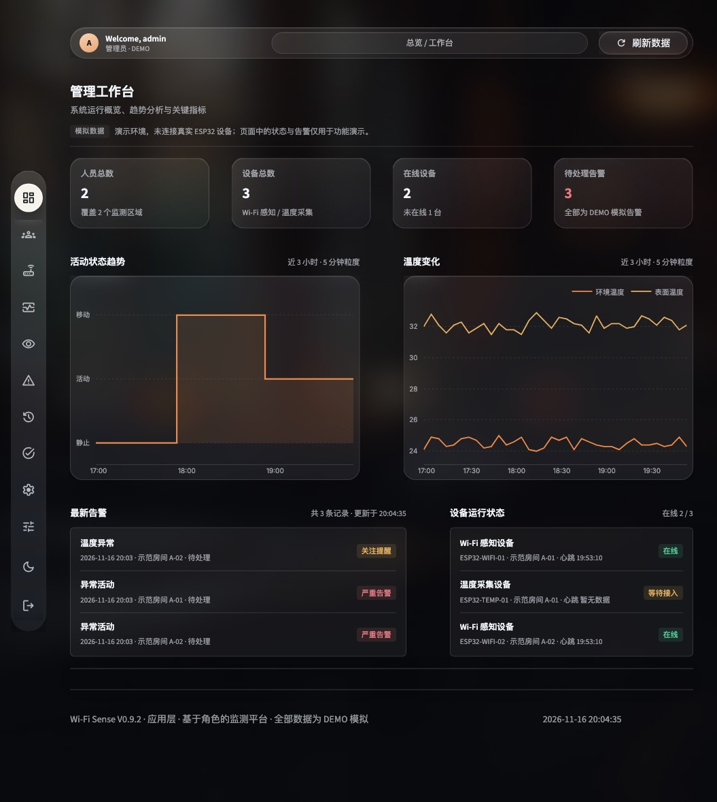
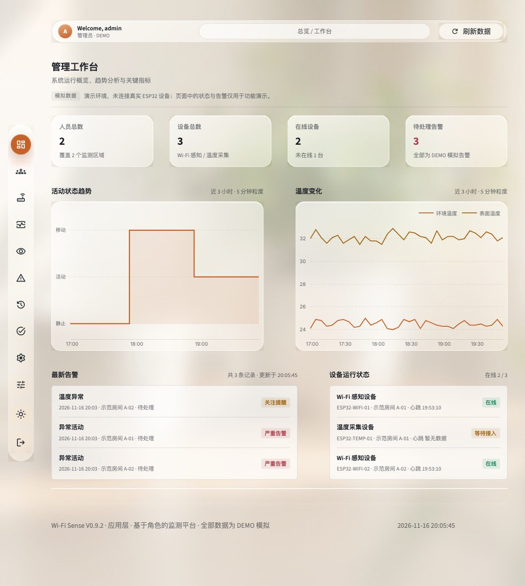

# Wi-Fi Sense

**Wi-Fi 感知（Wi-Fi CSI）家庭监护平台的「应用层」实现** —— 单文件 Streamlit 应用，把 ESP32 Wi-Fi 感知与温度传感的数据，组织成一套可直接上手的管理端 / 家属端界面。

A single-file Streamlit application layer for Wi-Fi CSI based home monitoring: role-based dashboards, live alerts, device and resident management, four switchable visual themes.

> 当前为 **DEMO** 版本：全部数据为模拟数据，未连接真实 ESP32 设备与感知算法。接口契约已备好，填入 `WIFI_SENSE_API_BASE` 即切换到真实后端。



*深色玻璃（`glass`，默认）：暖光虚化底图 + 磨砂卡片 + 左侧窄玻璃胶囊导航*



*浅色玻璃（`glass_light`）：浅木日光底图 + 白玻璃卡片，同一套布局*

## 功能

### 页面矩阵

**管理员**

| 分区 | 页面 | 内容 |
|---|---|---|
| 总览 | 管理工作台 | 人员总数 / 设备总数 / 在线设备 / 待处理告警四张指标卡；活动状态趋势（近 3 小时，5 分钟粒度）；环境温度与表面温度双线图；最新告警预览 + 「查看全部」；设备运行状态列表（在线 / 等待接入 / 心跳时间） |
| 资产 | 人员档案管理 | 人员新增与编辑、绑定监测区域、角色关系、最近心跳 |
| 资产 | 设备管理 | Wi-Fi 感知设备与温度采集设备、型号与固件、在线状态与最后上报 |
| 监测 | 实时监测 | 按监测区域查看三张指标卡（当前活动状态、环境温度及阈值、表面温度及阈值）；「空间状态」三维视图支持拖动旋转、滚轮缩放、点击房间选中，并显示该房间的详情浮层 |
| 监测 | 留意 | 需要重点关注的对象与异常迹象汇总 |
| 监测 | 告警中心 | 全部 / 待处理 / 已确认指标卡；DEMO 告警生成；状态、级别、区域三筛选；每页 20 条分页；单条确认；导出筛选后全量 CSV |
| 监测 | 历史数据 | 按时间范围查询历史指标与记录 |
| 监测 | 监测任务 | 任务清单、执行状态与结果 |
| 系统 | 设置 | 四套风格卡切换、信息密度、减少动效、卡片细节开关、自动每日简报 |
| 系统 | 系统配置 | 识别参数、监测区域、阈值配置 |

**家属**

| 分区 | 页面 | 内容 |
|---|---|---|
| 总览 | 家庭监护首页 | 绑定人员的当日概况与异常提示 |
| 总览 | 实时监护画面 | 家庭视角的实时活动与温度状态 |
| 总览 | 留意 | 关注对象的异常迹象 |
| 告警 | 我的告警 | 与本人相关的待处理告警 |
| 告警 | 历史告警记录 | 本人历史告警查询 |
| 账户 | 个人信息 | 姓名、关系、绑定区域 |
| 账户 | 设置 | 风格切换与显示偏好 |

导航按角色动态生成：左侧窄图标胶囊（含分组、当前页高亮、折叠态），顶栏为连续玻璃胶囊 + 页面路径。

### 指标与数据口径

所有指标卡都带副标题说明取值来源与口径，避免"数字很漂亮但不知道算的什么"。

| 位置 | 指标 | 含义与口径 |
|---|---|---|
| 管理工作台 | 人员总数 | 已建档人员数，副标题标注覆盖的监测区域数 |
| 管理工作台 | 设备总数 | Wi-Fi 感知设备 + 温度采集设备合计，副标题按类型拆分 |
| 管理工作台 | 在线设备 | 心跳在 3 个上报周期（15 分钟）内的设备数，副标题标注"未在线 N 台" |
| 管理工作台 | 待处理告警 | 状态为「待处理」的告警条数，副标题标注数据来源（DEMO / 真实） |
| 管理工作台 | 活动状态趋势 | 近 3 小时、5 分钟粒度；纵轴为识别结果三档：静止 / 活动 / 移动 |
| 管理工作台 | 温度变化 | 近 3 小时、5 分钟粒度；环境温度与表面温度双线，缺来源的曲线不画假数据 |
| 管理工作台 | 设备运行状态 | 每台设备的在线 / 等待接入 / 离线状态、型号、最后心跳时间 |
| 告警中心 | 全部告警 | 含已确认的累计条数 |
| 告警中心 | 待处理 | 需管理员确认的条数 |
| 告警中心 | 已确认 | 已完成处理的条数 |
| 实时监测 | 当前活动状态 | 所选区域的识别结果（静止 / 活动 / 移动），DEMO 为模拟识别 |
| 实时监测 | 环境温度 | 当前值 + 预设阈值，超阈值时高亮 |
| 实时监测 | 表面温度 | 当前值 + 预设阈值；无传感器来源时显示「暂无数据」而不是填 0 |

刷新节奏上区分两种：**指标卡跟随整页刷新**（切页或点「刷新数据」触发全量 `hydrate()`），**告警列表 30 秒自动轮询**。这是有意取舍——轮询只拉告警，避免每 30 秒重算全量聚合。

### 空间状态（三维视图）

管理员「实时监测」与家属「实时监护画面」里各有一块空间视图，是**可交互的**，不是静态配图：

- **实现**：Canvas 2D 自绘的等距（isometric）投影，不依赖 WebGL 或第三方 3D 库，因此在容器与低配浏览器里也能稳定渲染
- **拖动旋转**：按下拖动改变偏航角，房间平面随视角转动
- **滚轮缩放**：滚动改变缩放倍数，用于贴近看单个房间或退回看整体
- **点击房间**：点中房间面即选中并高亮，同时弹出该房间的详情浮层（房间名、状态级别、当前情况描述、建议动作、数据来源）
- **左侧 HUD**：房间数、设备在线 x/y、待处理告警、房间有活动，四行实时汇总
- **右侧房间列表**：每个房间的活动等级与温度，与图内颜色一一对应（红=有告警、绿=活动、蓝=静止）
- **摄像头与骨骼**：在线摄像头上报 COCO-17 关键点时，三维里会在该房间画出一个「站立的」人体骨架，动作按帧序列循环播放；HUD 同步给出「摄像头 x/y（在线）」，点击房间的浮层里注明骨架来自哪一路、帧率、帧数与置信度
- **隐私边界**：只传关键点，不传原始画面；骨架可在「设置 → 显示内容 → 三维显示骨骼视角」关掉，关掉后 HUD 的骨骼计数随之消失

已知不足：这块视图底色写死深色，浅色玻璃主题下与周围卡片对比偏硬；骨架是 2D 关键点在等距空间里「扶正」渲染，用来表达房间内的人形动作，不是真三维人体模型（不做骨骼蒙皮与深度遮挡）。


- **告警 30 秒局部轮询**：工作台「最新告警」与告警中心列表各自用 `@st.fragment(run_every=30s)` 刷新，每次只打一个告警接口，不整页重绘、不打断页面上的其他操作；列表标题标注「更新于 hh:mm:ss」
- **刷新失败降级**：保留上一次成功数据，只在列表下方写一行提示，不弹整页错误、不清空已加载内容
- **缓存分层**：非轮询读取走 8 秒进程内缓存（`WIFI_SENSE_API_TTL`），轮询请求显式绕过缓存，保证拿到的是新数据
- **分页与筛选**：筛选变化自动回到第 1 页；页码用普通会话变量管理，避免修改已实例化的控件状态
- **导出**：导出的是筛选后的全量记录，不只导出当前页
- **时间统一**：显示层固定按 `Asia/Shanghai`，从 UTC 绝对时间换算，容器时区（UTC / 本地）不影响界面输出

### 视觉与交互

- 四套主题：深色玻璃 `glass`（默认）、浅色玻璃 `glass_light`、经典深色 `dark`、经典浅色 `light`；后两者保持原版宽侧栏布局
- 设置页 2×2 风格卡**整卡可点**切换（无二次确认按钮），当前风格标「使用中」
- 主题跨刷新持久化：地址栏 `ws_t` 兜底，接入偏好接口后以服务端为准
- Apple 风格动效：卡片入场 0.4s 缓起上浮、顶栏胶囊下落、按钮与图标栏悬停轻缩放；仅玻璃两套生效，尊重「减少动效」开关与 `prefers-reduced-motion`
- 登录页「记住我」：勾选后 30 天免登录，不勾为 2 小时

### 工程实现

- **单文件**：全部逻辑在 `app.py`，主题系统为「CSS 变量 + 调色板字典 + 模板占位替换」，新增风格只需加调色板与少量覆盖 CSS，不引进构建链
- **数据源抽象**：`BaseDataSource` / `DemoDataSource` / `HttpDataSource` 三层，页面只依赖抽象层，切真实后端不改页面代码
- **接口契约**：`API_CONTRACT` 集中声明认证、人员、设备、遥测、告警、任务、识别参数与健康检查
- **鉴权**：前端会话令牌 `ws_s` 仅用于「刷新不掉线」，不含权限判断；401/403 会清令牌并要求重新登录
- **可配置**：轮询周期、条数上限、页大小、超时、缓存全部走环境变量，后端压力大时调参数即可

## 运行

```bash
python -m venv .venv
source .venv/bin/activate
pip install -r requirements.txt
streamlit run app.py --server.port 8501
```

Python 3.12（见 `runtime.txt`），依赖版本已锁定在 `requirements.txt`。

**演示账号**（仅访问模拟数据，无真实权限）

| 账号 | 密码 | 角色 |
|---|---|---|
| `admin` | `admin123` | 管理员 |
| `family` | `family123` | 家属（人员 P001） |
| `family2` | `family123` | 家属（人员 P002） |

## 配置

| 环境变量 | 默认 | 说明 |
|---|---|---|
| `WIFI_SENSE_API_BASE` | 空 | 后端基址；留空使用内置 DEMO 数据源 |
| `WIFI_SENSE_API_TIMEOUT` | 10 | 单次请求超时（秒） |
| `WIFI_SENSE_API_TTL` | 8 | 非轮询请求的进程内缓存（秒），轮询接口不使用缓存 |
| `WIFI_SENSE_ALERT_POLL` | 30 | 告警轮询周期（秒），设 `0` 关闭 |
| `WIFI_SENSE_ALERT_LIMIT` | 200 | 单次拉取告警条数上限 |
| `WIFI_SENSE_ALERTS_PAGE_SIZE` | 20 | 告警中心每页条数 |
| `WS_SESSION_SECRET` | 本地占位值 | 前端会话令牌签名密钥，**生产环境必须替换** |

## 目录结构

```
app.py                          # 全部应用代码（单文件）
assets/bg.jpg                   # 深色玻璃底图
assets/bg_light.jpg             # 浅色玻璃底图
.streamlit/config.toml          # Streamlit 主题与服务器配置
docs/后端交接-一页纸.md          # 接口对接开场对齐
docs/后端交接-接口与状态补充.md   # 字段约束、异常态、刷新策略
docs/screenshots/               # README 用截图
requirements.txt
runtime.txt
LICENSE
```

## 接口

请求/响应契约见 `app.py` 的 `API_CONTRACT`。接后端只需实现 `HttpDataSource` 对应的接口，页面代码无需改动。

摄像头与骨骼是两条独立接口（`BaseDataSource` 已定契约，Demo / Http 两种数据源都已实现）：

- `GET /api/v1/cameras` → `[{id, room, name, status, fps, pose, stream, last_seen}]`；`pose=true` 表示该路上报关键点，`stream=false` 表示不拉流
- `GET /api/v1/poses?frames=30` → `{rooms: {房间名: {camera_id, fps, activity, confidence, frames: [{ts, kp}]}}}`；`kp` 为 COCO-17 的 `[[u,v,score], ...]`，`u/v` 是房间内归一化坐标（0–1）

两条约定：**只传关键点、不传画面**（隐私底线，接口不应返回图像）；帧序列一次返回一小段（默认 30 帧 ≈ 2 秒）由前端循环播放，这样骨架能连续动，又不需要高频轮询整页重渲染。

需要后端配合的重点见 `docs/后端交接-一页纸.md`：告警接口参数、分页边界、四类异常态、时间戳统一用 UTC 毫秒等。

## 已知限制

- 真实后端尚未联调，HTTP 数据源只有契约与实现，未与真实服务验证
- 告警分页覆盖最近 200 条，更早记录需后端提供 `offset` / `before`
- 告警顶部三张指标卡不参与轮询，只随整页刷新更新（有意取舍，避免每 30 秒重算全量）
- 登录鉴权为前端演示实现，`ws_s` 不承担权限判断
- 未做移动端布局（当前按 1440 宽设计）
- 「空间状态」三维视图底色写死深色，浅色主题下对比偏硬（交互本身不受影响）
- 通知推送通道只有设置项，未接浏览器通知 / 短信 / App

## 免责声明

本项目是家庭监护场景的原型与演示系统，**不是医疗设备、安防产品或安全认证产品**，不可用于医疗诊断、生命安全或安防值守。演示模式下的所有数据均为模拟生成。

## 许可

[MIT](LICENSE)
